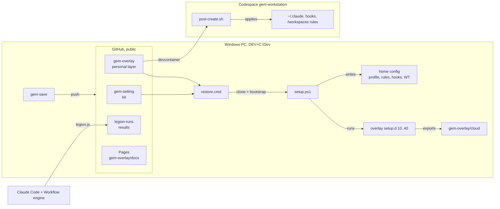

# Architecture

Boseok's portable multi-agent workstation, as of 2026-10-28. One page, dense on purpose: every
repository, flow, invariant, decision, measurement and file. Korean how-to: [MIGRATE.ko.md](MIGRATE.ko.md).

## 0. Summary

- **Definition = 2 repos.** `gem-setting` (the kit: apps, profile, agent rules, git hooks, terminal;
  based on dev-starter; its original credit line stays in the kit README and START-HERE.ko) + `gem-overlay` (everything
  personal: identity, rule fragments, setup hooks, skills, backup/restore, cloud). A third repo,
  `legion-runs`, keeps agent-legion results. All three: public, on GitHub, account `speddiikga-code`.
- **One command per job.** Build a PC: `restore.cmd`. Re-apply: `gem-setup` (setup.ps1 without `-Apps`; `gem-setup -Apps` also reruns winget/uv). Back up: `gem-save`.
  Cloud: a Codespace from `gem-overlay`. Fan out work: the `legion` skill.
- **Every agent reads one rule set**, generated by setup and copied to Claude Code, Codex, Gemini,
  OpenCode, and the Codespace.
- **This laptop is disposable.** Only GitHub is durable; employer files (Documents/Downloads) sit on this laptop but are never uploaded to GitHub, so they are not backed up.

## 1. Topology



| Place | What | Where |
|---|---|---|
| Kit repo | installer + core config | `github.com/speddiikga-code/gem-setting`, `C:\Dev\gem-setting` |
| Overlay repo | personal layer, tools, cloud | `github.com/speddiikga-code/gem-overlay`, `C:\Dev\gem-overlay` |
| Results repo | legion outputs | `github.com/speddiikga-code/legion-runs`, `C:\Dev\legion-runs` |
| Codespace | cloud workstation, Ubuntu 24.04, 2-core, idle stop 30 min | `gem-workstation-wv9xwrj95665c7rx`, `https://gem-workstation-wv9xwrj95665c7rx.github.dev` |
| Public pages | mission board (planner only), 3D overview | `https://speddiikga-code.github.io/gem-overlay/` and `/gem-setting-3d.html` |
| Claude artifacts (private) | 3D page; mission board with shared store | `claude.ai/artifact/MXnnLYm2GMRyJiM6Vf3a3D`; `claude.ai/artifact/9nmY2x95PSQVmtxpwjdhts` |
| Original zip copy | kit as received (files identical to import commit `197d3dd`); Claude Code sessions run here, so it also holds `.claude/settings.local.json` | `%USERPROFILE%\Documents\gem-setting` |

## 2. Kit: gem-setting

**Chain.** `START.cmd` (cmd, `pause` at end) -> `bootstrap.ps1` (Windows PowerShell 5.1, ASCII
only: refuse args containing `"`, Unblock-File, find or install pwsh via winget) ->
`setup.ps1 -Apps <args>`, plus `-Language Korean` unless `<args>` has `-Language` (pwsh 7, `-ExecutionPolicy Bypass`; exit code passed back through START.cmd).

**setup.ps1 steps** (each idempotent; a failed native command, missing winget/uv/git, a bad Claude settings file or a
failed setup.d hook is listed and the run continues, exit 1 at the end; any other PowerShell error
(missing `-Overlay` dir, unparsable overlay `config.json`, write error) aborts the run):

| # | Step | Effect |
|---|---|---|
| 0 | env | non-sandbox: reload `DEV`, `AGENT_LANGUAGE`, `DEVSTARTER_OVERLAY` from user env (fix #4) |
| 1 | overlay | `-Overlay <dir>` saved as `DEVSTARTER_OVERLAY` (missing dir = abort); saved path gone = warning, no overlay; reads `config.json`; `DEVSTARTER_ROOT` = kit for setup.d |
| 2 | DEV | `-Dev` > overlay `dev` > `$env:DEV` > `%USERPROFILE%\dev`; env vars expanded, folder created, saved as user var |
| 3 | vars | `AGENT_LANGUAGE`; `UV_PYTHON_PREFERENCE=only-managed` always (fix #7) |
| 4 | apps (`-Apps`) | `winget import` of winget.json + overlay ids, `--no-upgrade`; `uv python install 3.13 --default`; `uv python update-shell` |
| 5 | tools (`-Tools`) | `tools.ps1`: tools.json + overlay `tools` |
| 6 | profile | `profile.ps1` -> `$PROFILE` (UTF-8 console, `[user@host] PS path>`) |
| 7 | DEV rules | `AGENTS.md` and `CLAUDE.md` (`@AGENTS.md`) into DEV |
| 8 | git identity | needs git (no git = one listed failure, 8 and 11 skipped); params > overlay `git.*` (overwrites a different global value) > prompt (only if unset and stdin not redirected) |
| 9 | global rules | `claude-global.md` (`<YOUR_NAME>` = overlay `name` > git `user.name` > `USERNAME`; `<LANGUAGE>` = `AGENT_LANGUAGE` or English) + overlay `rules/*.md` in name order -> `~/.claude/CLAUDE.md`, `~/.codex/AGENTS.md`, `~/.gemini/GEMINI.md`, `~/.config/opencode/AGENTS.md` |
| 10 | Claude settings | `attribution = {commit:"", pr:"", sessionUrl:false}`; non-object JSON = failed step, not abort (fix #8) |
| 11 | hooks | needs git; `commit-msg` + 18 forwarders + `pre-push` = 20 files in `~/.config/git/hooks` (LF); global `core.hooksPath` set there, a different existing value overwritten with a warning |
| 12 | terminal | only if WT `LocalState` exists (WT opened once), else skipped with a note, not listed as failed; `terminal/settings.json` with `__STARTER__` = kit path replaces `LocalState\settings.json` |
| 13 | overlay hooks | `setup.d/*.ps1` in name order, each in its own pwsh; failures listed |

**Invariants.** `[CmdletBinding(PositionalBinding=$false)]` (fix #8). `Write-IfChanged` compares with
`-ceq`, writes only on change. `Backup-File`: first replacement -> `<file>.bak` kept forever, later
ones -> `<file>.<yyyyMMdd-HHmmss>.bak` (fix #5). `~/.gitconfig` is edited key by key, never backed up
or replaced. `DEVSTARTER_SANDBOX=<dir>` redirects home files, `$PROFILE`, `LOCALAPPDATA` (Terminal), global git
config and user variables, ignores saved user vars, skips `uv python update-shell`; `-Apps`/`-Tools`
still install for real and `-Dev`/`-Overlay` still put DEV rules outside it. The kit's
`tests\run.ps1` is not in this copy.

**Hooks.**
- `commit-msg` (`LC_ALL=C sed -i -E`): drops co-author trailers by AI-tool address (anthropic.com,
  openai.com, Copilot noreply, cursor, opencode.ai, codeium, windsurf, tabnine, devin, gemini,
  jules, aider) or bare tool name without address; `Claude-Session:`; lines that start (after
  non-alphanumerics) with `generated with|by <tool>` (fixes #1, #2). Then repo hook.
- `forward-hook`, copied as 18 names: `applypatch-msg pre-applypatch post-applypatch pre-commit
  pre-merge-commit prepare-commit-msg post-commit pre-rebase post-checkout post-merge post-rewrite
  pre-auto-gc sendemail-validate` + receive side `pre-receive update post-receive post-update
  proc-receive` (push-to-deploy). Not forwarded: `push-to-checkout` (its presence disables git's
  updateInstead checkout), `reference-transaction`, `post-index-change` (sh per ref/index write),
  git-p4's `p4-*` hooks. Repo hooks found via `--git-common-dir` (worktrees, fix #3).
- `pre-push`: reads refs once; if not bare, `.github/workflows/lint.yml` pins `ruff@<ver>`
  (comments ignored) and `uvx` exists: `uvx ruff@<ver>` `check`/`format --check` on the working
  tree (uncommitted changes count) only as lint.yml runs them (both if undetectable), no pin = no
  lint; `LOCAL_CI_TESTS=1` adds `uv run pytest -q -x` (needs pyproject.toml + tests/);
  `SKIP_LOCAL_CI=1` skips both; `git lfs pre-push` when `git-lfs` exists and
  `<common-dir>/lfs/objects` exists or `--no-literal-pathspecs ls-files ':(attr:filter=lfs)'`
  lists files, unless the repo hook already calls it; its failure aborts the push (fix #6); then
  repo hook with the same refs.

**Other kit files.** `tools.ps1` (`-Only/-Update/-DryRun`; gh-kind crash fixed, #10).
`extras/office-view.ps1` (`publish/render/pdf` for PowerPoint; paths resolved against `$PWD`,
`-LiteralPath`, fix #9) + `office-view-crop.py`. Docs: README, START-HERE.ko, ASK-YOUR-AI.ko.

## 3. Overlay: gem-overlay

**config.json** (public repo, so the email is published): git `Boseok Kang`/`speddiikga@gmail.com`
(setup writes it over any differing global identity; post-create only fills an unset one), name
(`<YOUR_NAME>`), `dev=%SystemDrive%\Dev` (loses to `-Dev`, beats `$env:DEV`), language Korean, winget
`BurntSushi.ripgrep.MSVC`, `jqlang.jq`.

**rules/** (appended to every agent's global rules): `10-work-style` (tool-ify repeats, text not
pixels, shrink inputs, EN/KO prompts); `20-shared-environment` (one definition; never edit
generated copies; one worktree+branch per parallel agent; push what matters, but ask before
`gem-save` or any push).

**setup.d/** (run by the kit in name order, each in its own `pwsh -NoProfile`, failures listed;
10/20/30 sandbox-aware, 40 writes the real overlay's `cloud/` even under `DEVSTARTER_SANDBOX`;
save.ps1 also runs 40):

| Hook | Does |
|---|---|
| `10-claude-code` | installs Claude Code CLI (`irm https://claude.ai/install.ps1 \| iex` in a child pwsh) if missing |
| `20-claude-skills` | copies `skills/*` (minus `tests`, `__pycache__`, `.pytest_cache`) to `~/.claude/skills`, hash-compared; never deletes (a removed or renamed skill stays until deleted by hand; same in post-create) |
| `30-profile` | writes pwsh AllHosts profile: `gem-save`, `gem-setup`, `gem-restore-help` |
| `40-cloud-export` | copies generated `CLAUDE.md`, DEV `AGENTS.md`, kit hooks (LF) to `cloud/`; skips `cloud/CLAUDE.md` while the generated rules lack any `rules/*.md` (rest still refreshed); any skip = exit 1; `-DryRun` exits 2 if it would write |

**save.ps1** (`gem-save [-DryRun]`): repos under DEV to depth 2 + linked worktrees elsewhere ->
one status line each (clean+pushed / pushed / uncommitted / unpushed, no or deleted upstream / no
remote / detached-HEAD commits / stashes, not backed up / push failed / git error); pushes, without
fetching, every branch ahead of its
upstream; never commits other repos; rewrites `repos.txt` (`owner/name relative\path`, github
origins, kit+overlay excluded); runs `40-cloud-export`; commits every pending overlay change (`git
add -A`, untracked files included; public repo) as `chore: save workstation state` in
the overlay and pushes; git output decoded as UTF-8; exit 1 while anything is only local or a
push, the overlay commit or the cloud export failed.

**restore.cmd -> restore.ps1** (5.1, ASCII, `-DryRun`): needs git, gh, `gh auth status`;
`gh auth setup-git`; `pull --ff-only` overlay; `pull --ff-only` or clone `gem-setting` beside it
(clone uses the signed-in gh account, so sign in as `speddiikga-code`; clone failure = exit 1); clone missing
`repos.txt` entries (read as UTF-8); run `System32\...\powershell.exe bootstrap.ps1 -Overlay
<overlay> -Dev <parent>`; problems listed, exit code passed on.

**Codespace** (`.devcontainer/`): `base:ubuntu-24.04` + features node lts, github-cli, sshd;
env `AGENT_LANGUAGE`, `UV_PYTHON_PREFERENCE`, `DEV=/workspaces`. `post-create.sh` (idempotent;
`GEM_SKIP_INSTALL=1`, `GEM_WORKSPACES=<dir>`): uv, Python 3.13, Claude Code; `cloud/CLAUDE.md`
to the 4 agent rule files; skills; attribution; hooks + `core.hooksPath`; git identity from
config.json when no global one (Codespaces puts the login in `/etc/gitconfig`); `/workspaces/
AGENTS.md` + `CLAUDE.md`; SSH sessions: bashrc loads `GITHUB_TOKEN` from
`/workspaces/.codespaces/shared/.env`, git falls back to `!gh auth git-credential`.

**site/ -> docs/**: `site/*.html` are artifact bodies; `uv run site/build_pages.py` wraps the pages
listed in its `PAGES` map (add new ones there), plus `.nojekyll`, in
a document skeleton into `docs/` (`index.html` = mission board) for GitHub Pages (`main:/docs`).

## 4. Skills

**kakao-slice** (`kakao_slice.py`, stdlib, PEP 723): KakaoTalk export -> `YYYY-MM-DD HH:MM Name:
text`. Formats (the first message line locks one): PC KO/EN, Android KO, iOS KO (12h/24h), EN mobile
(`October 27, 2026 at 1:19 PM, Name : text`), EN mobile short (`10/27/26, 1:19 PM - Name: text`).
Input: UTF-8 (BOM ok), UTF-16, CP949, CRLF. Notices dropped. Exit 1 plus the format list when
nothing parses. Options: `--list --months
--stats --date --from --to --last N --sender --grep -o`. 47 pytest cases.

**legion** (`legion.js` Workflow script, `SKILL.md`, `legion_report.py`):
- Node = 1 agent: `solve` or `split` into 2..k self-contained subtasks (k = min(`branching`, free
  slots); extra subtasks dropped; fewer than 2 = leaf). Children run concurrently. `run` only: the
  parent merges (`result` holds only the deliverable; `notes` and `gaps` separate; each child
  result cut at 8000 chars; a failed merge joins the children as `## title` sections), and a
  critic reviews the root result unless `review:false`. `plan`: agents only decide and describe
  the work in 2-4 sentences; no merges, no critic. The script keeps the tree: a solve/split agent
  sees the root goal, `context`, its task and the ancestor titles; a merge agent also sees its
  children's results.
- Budget: the root and the critic are pre-reserved. Before its own decide call, each node that
  may split reserves `k` children (+1 merge in `run`) and releases the unused slots once it
  decides, so the total agent count (not concurrency) never exceeds `maxAgents`. A split is
  blocked at `maxDepth`, when k<2, or, when the run has a token budget, at `budget.remaining()`
  <=40k.
- Args (default): `goal` (required; a bare string = goal), `mode plan|run` (plan), `preset tiny
  12/3/3 | squad 40/5/4 | legion 300/12/6 | max 950/40/8` (agents/depth/branching; squad, also
  for unknown names), `maxAgents 3-950`, `maxDepth 1-40`, `branching 2-12` (from preset),
  `minDepth 0..maxDepth` (0; levels above it must split), `context`, `isolation worktree`
  (solve/split agents only), `review` (true; run only), `effort low..max` (plan: low; run:
  session's), `mergeEffort` (medium), `model` (session's; solve/split/merge, not the critic).
- Runtime limits: 16 concurrent agents per workflow (min(16, CPUs-2); this PC has 18 CPUs),
  1000 agents per workflow.
- `legion_report.py <task output> [-o dir]` -> `$DEV/legion-runs/<today>-<mode>-<slug>/{result.json,report.md}`.
  The slug is the first 6 ASCII words of the goal (`run` for Korean-only goals); the same day,
  mode and slug overwrite the earlier run, so pass `-o`. Tokens go only in report.md. Commit and
  push by hand.

**Mission board** (artifact `9nmY2x...`): planner (preset+mode -> upper-bound pyramid, agents,
tokens at 54k/agent; minDepth 0-8 goes only into the paste-ready command) + shared board. Store: `missions/{auto}` `{goal, preset,
mode, minDepth, status queued|running|done, author, createdAt}`; `votes/{uid}` `{missions:[ids]}`.
Rules: `votes` read view / write owner; `votes/{self}` write interact; `missions` none (default:
read view, write interact, so any writer can edit or delete any mission; author/editor-only
controls are UI only). `user` scope profile. Outside Claude (Pages) the
board degrades to planner + link.

## 5. Measured (2026-10-28, this PC; agents/tokens also in `legion-runs/*/report.md`, times are not stored there)

| Run | Agents | Tokens | Time |
|---|---|---|---|
| plan, 20 cap/depth 4/branch 4, session effort | 11 (3 splits, depth 2) | 592k | 74 s |
| same, `effort: low` | 5 (1 split) | 268k | 20 s |
| run, solve only | 2 | 111k | 70 s |
| run, forced 3 levels (16 cap, minDepth 2, branch 2), session effort | 11 (3 merges) | 595k | 144 s |
| same, `effort: medium` | 11 | 590k | 63 s |

Cost ~54k tokens per agent regardless of task size (fixed starting context): cap agent count;
effort mostly buys time. Codespace boot to Available ~1-2 min; post-create a few minutes.

## 6. Decisions

- Personal settings in the overlay, never in the kit (kit stays identical everywhere).
- DEV at `C:\Dev` (root-level `Dev`, as the kit's author asked); config uses `%SystemDrive%\Dev`.
- Python from uv only; `only-managed` because the WindowsApps `python.exe` here is the Python
  install manager alias, which installs a runtime when probed.
- Depth as data, not nested live agents: no context loss per level, bounded cost.
- GitHub as the single source of truth; restore rebuilds, it does not copy disks.
- Employer documents in Documents/Downloads (~21 GB, mail, hwp) deliberately not uploaded.
- Commits: conventional, `Boseok Kang`, no AI credit lines; significant bugs get an issue first.

## 7. Incidents (all resolved unless noted)

| What | Cause | Resolution |
|---|---|---|
| Python 3.15.2 installed by pymanager | review agent ran `uv python list`, probing the alias | `py uninstall 3.15`; old 3.14 registry/shortcut leftovers were deleted by pymanager (not restorable); 2 pip shim leftovers remain in `%LOCALAPPDATA%\Python\bin` |
| codigest, git-deai, uv Python 3.15.2 installed | test harness ran `tools.ps1` without `-Only` | `uv tool uninstall`, `uv python uninstall 3.15` |
| Overlay rules dropped on rerun | issue #4 | fixed, re-applied |
| Original Terminal `.bak` at risk | issue #5 | copy kept as `settings.json.original`; fixed |
| Codespace git/gh signed out over SSH; cloud commits under login name | Codespaces env | post-create fixes (section 3) |

Issues #1-#10 in `gem-setting`: commit-msg ordinary lines (#1), human co-authors (#2), worktree
hooks (#3), rerun reset (#4), backups (#5), LFS (#6), uv probe (#7), arguments/settings (#8),
office-view paths (#9), tools.ps1 crash (#10). All closed: #5-#10 by `Fixes #N` commits (422613d #5/#7/#8, 5ba0921 #6, 0fb1cb7 #9, 8b1b467 #10);
#1-#4 by hand with 'Fixed in <sha>' comments (d61b052 #1/#2, 938812a #3, abf25d5 #4, fixed
2026-10-27). All ten were filed after the fact on 2026-10-28.

## 8. Limits and open items

- Logins are manual: PC `gh auth login` + `claude`; Codespace `claude` only (gh/git use the
  Codespaces `GITHUB_TOKEN`, which by default covers only gem-overlay; pushing other repos there
  needs `gh auth login` or `customizations.codespaces.repositories`).
- legion: `isolation: worktree` file-editing runs untested; only solve/split agents get worktrees,
  merges and the critic see text results only, and merging the branches is manual. Codespace:
  `legion-runs` is not cloned (post-create ignores `repos.txt`): run `gh repo clone
  speddiikga-code/legion-runs /workspaces/legion-runs` first, or `legion_report.py` writes an
  untracked folder.
- Mission board: posting and voting untested by a second person; artifacts are private until shared from their Share menu (db writes from outside the organization need an
  emailed Editor invite and no public link; Editor also lets them publish new page versions and
  rules, and edit or delete any mission).
- office-view: `render`/`pdf` need PowerPoint (untested); a read-only view file stops `publish`.
- LFS file locking hooks (post-checkout/commit/merge) are not called by forwarders.
- gem-save sees repos only to depth 2 under DEV (plus worktrees); work outside DEV is not saved.

## 9. Operations

```powershell
gem-setup                          # re-apply kit config + overlay hooks (pwsh 7); apps/Python only with -Apps
gem-save                           # push branches ahead of upstream, refresh repos.txt + cloud/, commit+push all overlay changes; lists what stays local
gem-save -DryRun
gh codespace create -R speddiikga-code/gem-overlay      # new Codespace; post-create runs once
gh codespace ssh -c gem-workstation-wv9xwrj95665c7rx
git pull && bash .devcontainer/post-create.sh           # inside the Codespace, after gem-save
gh codespace stop -c gem-workstation-wv9xwrj95665c7rx   # quota counts while running
uv run "$env:DEV\gem-overlay\site\build_pages.py"   # rebuild docs/ for Pages; gem-save (or a commit) publishes it
```

New PC: `winget install --id Git.Git -e --source winget`, `winget install --id GitHub.cli -e
--source winget`, new terminal, `gh auth login`, `gh repo clone gem-overlay
"$env:SystemDrive\Dev\gem-overlay"` (gh signed in as `speddiikga-code`), `& "$env:SystemDrive\Dev\gem-overlay\restore.cmd"`
(`-DryRun` to preview), new terminal, `claude` (sign in), `gem-save` (expect all clean).

Legion (in Claude Code): "legion으로 이 작업 나눠서 해 줘: <goal>" -> plan preview -> run ->
`legion_report.py` writes `$DEV/legion-runs/<date>-<mode>-<slug>/` -> commit + push in legion-runs
(gem-save does not commit it).

## 10. File index

**gem-setting** (kit)
```
START.cmd               double-click entry; runs bootstrap.ps1, pause
bootstrap.ps1           5.1: quote guard, unblock, install pwsh, run setup.ps1 -Apps (+ -Language Korean unless given)
setup.ps1               the whole setup (section 2)
winget.json             pwsh, Terminal, Git, gh, VS Code, uv, Node LTS
tools.json, tools.ps1   optional tools: codigest, git-deai (uv); overlay `tools` may add uv/gh/script entries
profile.ps1             pwsh profile: UTF-8, prompt
AGENTS.md               rules for repos under DEV (copied to DEV)
claude-global.md        global agent rules template (<YOUR_NAME>, <LANGUAGE>)
commit-msg              strips AI credit lines
forward-hook            hands over to the repo's own hook
pre-push                lint, tests, LFS, then repo hook
terminal/settings.json  Windows Terminal (pwsh default, %DEV%, Konsolas)
terminal/powershell_background.png
extras/office-view.ps1, extras/office-view-crop.py   publish (Office file -> view copy, `_viewN` if locked), render/pdf (PowerPoint; pdf cropped by office-view-crop.py)
docs/demo/*             README demo (session image, chart, script)
README.md, START-HERE.ko.md, ASK-YOUR-AI.ko.md       docs
.gitattributes          hooks LF, .cmd CRLF
```
**gem-overlay** (personal layer)
```
config.json             identity, DEV, language, extra winget ids
rules/10-work-style.md, rules/20-shared-environment.md
setup.d/10-claude-code.ps1, 20-claude-skills.ps1, 30-profile.ps1, 40-cloud-export.ps1
save.ps1                gem-save
restore.cmd, restore.ps1   rebuild a PC
repos.txt               repos restore clones (gem-save writes it)
cloud/CLAUDE.md, cloud/AGENTS.md, cloud/git-hooks/{commit-msg,forward-hook,pre-push}   export
.devcontainer/devcontainer.json, .devcontainer/post-create.sh   Codespace
skills/kakao-slice/{SKILL.md,kakao_slice.py,tests/test_kakao_slice.py}
skills/legion/{SKILL.md,legion.js,legion_report.py}
site/{gem-setting-3d.html,legion-board.html,build_pages.py}   artifact sources + Pages build
docs/{index.html,gem-setting-3d.html,.nojekyll}                 built Pages
README.md, MIGRATE.ko.md, KIT-FEEDBACK.md, ARCHITECTURE.md      docs
.gitattributes, .gitignore
```
**legion-runs**: `README.md` + one folder per run (`result.json`, `report.md`): 2 plan previews
(`2026-10-28-plan-write-a-research-brief-on-how` session effort, `-plan-tuned-low-effort`), 3 runs
(`-run-explain-git-worktrees-to-a-beginner` solve-only, `-run-write-a-beginner-cheat-sheet-with`
forced 3-level, `-run-tuned-merge-notes` forced 3-level tuned); tuned folders named with `-o`; no
timings stored.
